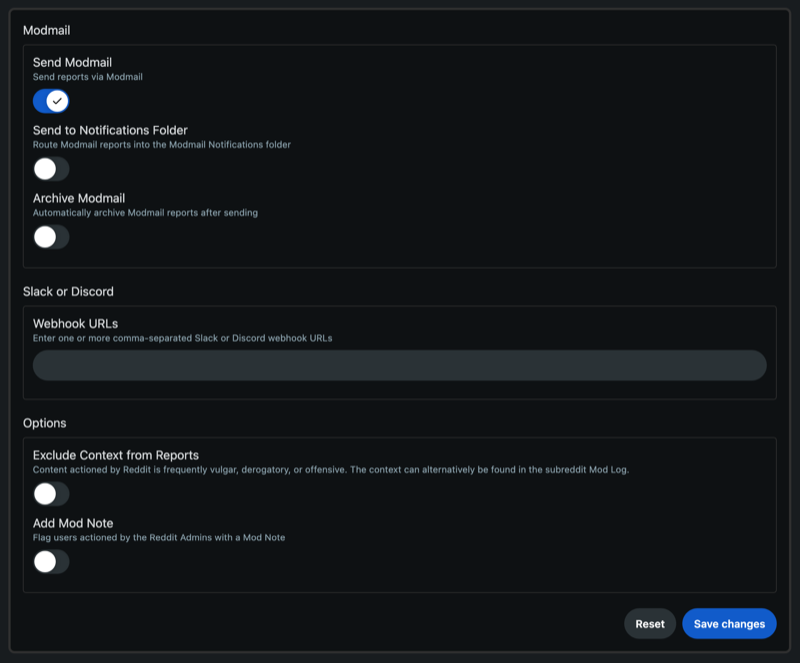
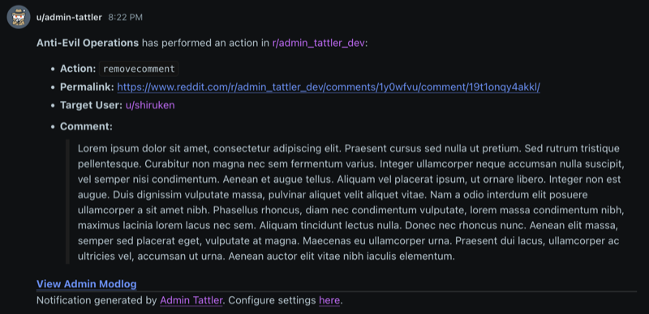
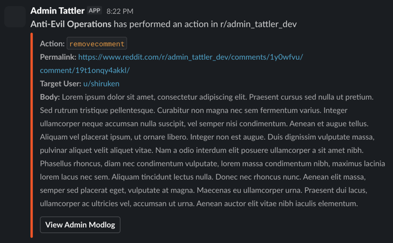
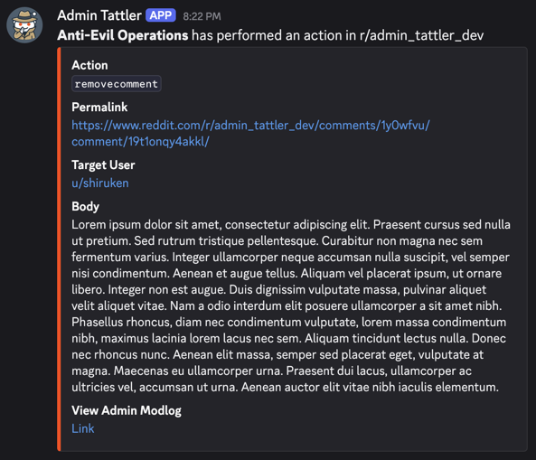
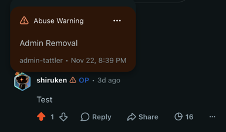

# Admin Tattler

Get notified when the Reddit Admins action content in your subreddit. Supports Modmail, Slack, and Discord.

[https://developers.reddit.com/apps/admin-tattler](https://developers.reddit.com/apps/admin-tattler)

## Features

* Minimal setup requiring **zero** knowledge about AutoModerator or coding
* Notifications via Modmail, Slack, and/or Discord
* Includes *original* post or comment text even after getting `[ Removed by Reddit ]`
* Flag actioned users with a Mod Note

## Installation Settings

* [Slack: Sending messages using incoming webhooks](https://docs.slack.dev/messaging/sending-messages-using-incoming-webhooks/)
* [Discord: Intro to Webhooks](https://support.discord.com/hc/en-us/articles/228383668-Intro-to-Webhooks)

## Notifications

### Modmail

### Slack

### Discord

## Moderation Actions

### Add Note

Mod Notes can (optionally) be added to users whose content was removed by the Reddit Admins

## Limitations

* This app does not account for actions taken by Admin accounts that get *added* to a subreddit's mod team.
* Notifications will be sent when temporary bans expire if the moderator responsible for the original ban has since left the mod team. This app is only aware of *current* moderators and cannot account for the delayed `unbanuser` action that gets scheduled for temporary bans.

## Recent Updates (v0.9)

* Thread follow-up Admin actions on the same post or comment into a single Modmail conversation *(New in v0.9.2)*
* Automatically delete app-created Mod Notes if Admins later approve the content *(New in v0.9.2)*
* Flag when actioned content was previously removed or approved by moderators
* Support multiple comma-separated Slack and Discord webhooks
* Option to route Modmail notifications to the Notifications folder
* Option to automatically archive Modmail notifications after sending
* Ignore false-positive `unsticky` alerts when users delete stickied content
* Prevent duplicate notifications for the same action
* Improved caching reliability and clearer messages when original content is unavailable

*[View full release history on GitHub](https://github.com/shiruken/admin-tattler/releases)*

## Links

* [Source Code](https://github.com/shiruken/admin-tattler)
* [Terms and Conditions](https://github.com/shiruken/admin-tattler/blob/main/TERMS.md)
* [Privacy Policy](https://github.com/shiruken/admin-tattler/blob/main/PRIVACY.md)
